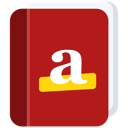
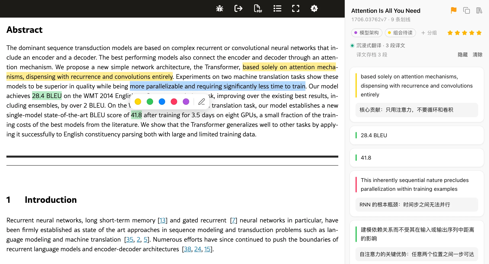
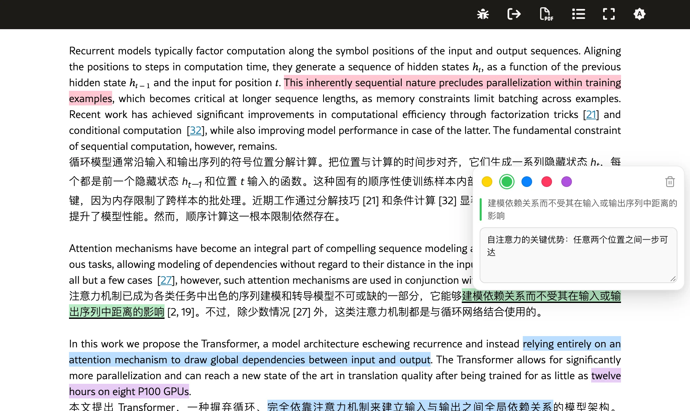
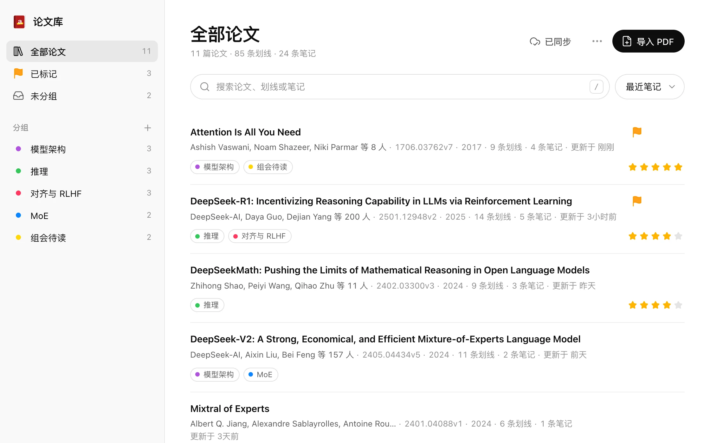

<div align="center">



# arXiv HTML Helper

**在 arXiv 论文上划线、写笔记，原文和译文都能划**

[](https://chromewebstore.google.com/detail/hckjdjhkldddjpaecpkpicfmpfggpfie)
[](LICENSE)

[Chrome 应用商店](https://chromewebstore.google.com/detail/hckjdjhkldddjpaecpkpicfmpfggpfie) · [项目主页](https://clamours.github.io/arxiv-html-helper/) · [使用说明](docs/usage.md) · [English](#english)

</div>

<table>
  <tr>
    <td>
      <picture>
        <source media="(prefers-color-scheme: dark)" srcset="site/img/hero-dark.webp">
        
      </picture>
    </td>
  </tr>
</table>

## 简介

arXiv 的 HTML 版论文适合在浏览器里读，配合沉浸式翻译、陪读蛙还能对照译文阅读。但想边读边划重点、记笔记时，浏览器本身做不到；常见的网页划线工具靠改写页面来标记文字，和翻译插件一起用时容易互相干扰。

arXiv HTML Helper 专为这种读法设计：原文和译文上都能划线、写笔记，翻译插件怎么重新渲染页面都不会丢；读过的论文自动收进论文库，可以分组、评分、搜索，查看摘要、写整篇论文的笔记，并在多台电脑之间同步。

## 功能

- **划线与笔记**：选中文字弹出工具栏，五种颜色一键高亮，或者高亮后直接写笔记；点击已有的高亮可以改色、编辑、删除
- **原文和译文都能划**：支持沉浸式翻译、陪读蛙的双语对照。高亮不修改页面结构，翻译插件重新渲染时也不会丢
- **译文存档**：翻译插件显示过的译文按段落自动存档。下次打开时不开翻译插件也能看到，措辞不变，译文上的笔记也不会漂移
- **侧边栏**：按原文顺序列出本篇的所有笔记，点击跳回原文位置；可以一键复制这篇论文的 BibTeX 引用
- **论文库**：读过的论文自动收录，标题和作者从 arXiv 获取；支持分组、标记、五星评分和多种排序，可以按标题、作者、划线和笔记内容搜索。点开一篇论文，右侧显示摘要、主分类、DOI、发表信息，还可以写整篇论文的笔记、复制 BibTeX 引用
- **同步与备份**：通过 WebDAV（坚果云、Nextcloud、群晖等）或 Google Drive 在多台电脑之间同步，也可以导出、导入备份文件
- **导入 PDF**：没有 HTML 版本的论文，可以用 MinerU 把 PDF 转成同样结构的页面，一样能划线、翻译

<table>
  <tr>
    <td width="50%">
      <picture>
        <source media="(prefers-color-scheme: dark)" srcset="site/img/translation-dark.webp">
        
      </picture>
    </td>
    <td width="50%">
      <picture>
        <source media="(prefers-color-scheme: dark)" srcset="site/img/library-dark.webp">
        
      </picture>
    </td>
  </tr>
  <tr>
    <td align="center">在译文上划线、写笔记</td>
    <td align="center">论文库：点开论文看摘要、DOI 和笔记</td>
  </tr>
</table>

## 安装

从 [Chrome 应用商店](https://chromewebstore.google.com/detail/hckjdjhkldddjpaecpkpicfmpfggpfie) 安装，之后会自动更新。

### 从 GitHub 安装

访问不了 Chrome 应用商店时，可以用 [Releases](https://github.com/Clamours/arxiv-html-helper/releases) 里的 zip：

1. 下载最新版本的 `arxiv-html-helper-<版本>.zip`，解压到一个固定的文件夹（之后不要删除或移动）
2. 打开 `chrome://extensions`，开启右上角的"开发者模式"
3. 点"加载已解压的扩展程序"，选择这个文件夹

这个包和商店版代码相同、扩展 ID 相同，但不会自动更新。升级时清空原文件夹，解压新版本进去，再在 `chrome://extensions` 点扩展卡片上的刷新按钮，笔记都会保留；不要点"移除"，移除会删掉扩展的数据。想换成商店版时，先在论文库导出备份（或开启云同步），移除 GitHub 版，从商店安装后再导入。

## 快速上手

1. 打开任意一篇 arXiv HTML 论文，比如 [Attention Is All You Need](https://arxiv.org/html/1706.03762v7)
2. 选中一段文字，在弹出的工具栏里点一种颜色即可划线；点铅笔图标还能写笔记
3. 点浏览器工具栏里的扩展图标打开侧边栏，查看本篇的全部笔记；侧边栏右上角可以进入论文库

支持 `arxiv.org/html/…` 和 `ar5iv.org/html/…` 的论文页面。在论文摘要页（`arxiv.org/abs/…`）上，点 "HTML" 链接进入 HTML 版本。

## 隐私

扩展没有自己的服务器，不收集、不统计任何数据，也不含广告和分析代码。笔记、论文库和译文存档默认只保存在本机浏览器里；开启云同步后，只写到你自己的 WebDAV 服务器或 Google Drive。论文库和复制引用时会向 arXiv API 查询标题、作者、摘要等论文信息，导入 PDF 时文件会上传到 MinerU 解析。详见[隐私政策](https://clamours.github.io/arxiv-html-helper/privacy.html)。

## 文档

- [使用说明](docs/usage.md)：侧边栏、论文库、详情面板、复制引用、分组、评分、备份
- [译文存档](docs/saved-translations.md)：译文怎样存档、什么时候更新
- [云同步](docs/sync.md)：WebDAV 和 Google Drive 的设置、合并规则
- [导入 PDF](docs/import.md)：用 MinerU 把 PDF 转成可以划线的论文页面
- [开发指南](docs/development.md)：构建、测试、发布和代码结构

## 参与开发

用 [WXT](https://wxt.dev) 和 TypeScript 开发，界面是原生 DOM，没有用前端框架。

```bash
npm install
npm run dev   # 启动开发模式，自动打开一个装好扩展的 Chrome
npm test
```

构建与发布、设计思路、代码结构和测试方法见[开发指南](docs/development.md)。有问题或建议，欢迎提 [Issue](https://github.com/Clamours/arxiv-html-helper/issues)。

## 许可

[MIT](LICENSE)。本项目与 arXiv 及 Cornell University 无任何关联。

## English

arXiv HTML Helper is a Chrome extension for highlighting and taking notes on arXiv HTML papers, on the original text and on translations shown by Immersive Translate or Read Frog. Highlights never modify the page, so they survive when the translator re-renders it, and translated paragraphs are saved so notes on them never drift. Papers you read go into a library with groups, ratings, full-text search, abstracts, paper-level notes and one-click BibTeX, synced across computers via WebDAV or Google Drive.

The interface is in Chinese. Install it from the [Chrome Web Store](https://chromewebstore.google.com/detail/hckjdjhkldddjpaecpkpicfmpfggpfie), or read more on the [project website](https://clamours.github.io/arxiv-html-helper/?lang=en).
